#+TITLE: pymodalshaker --- User Manual and Technical Documentation
#+SUBTITLE: PySide6 + NI-DAQmx application for shaker modal testing with NI CompactDAQ
#+AUTHOR: The pymodalshaker authors
#+DATE: Version 0.1.0b1 (first beta), 4 November 2026
#+LANGUAGE: en
#+OPTIONS: toc:2 num:t ^:{} H:4 broken-links:mark
#+STARTUP: overview
#+LATEX_CLASS: article
#+LATEX_CLASS_OPTIONS: [a4paper,11pt]
#+LATEX_HEADER: \usepackage[margin=2.2cm]{geometry}
#+LATEX_HEADER: \usepackage{lmodern}
#+LATEX_HEADER: \usepackage{textcomp}
#+LATEX_HEADER: \usepackage{amssymb}
#+LATEX_HEADER: \usepackage{newunicodechar}
#+LATEX_HEADER: \newunicodechar{Δ}{\ensuremath{\Delta}}
#+LATEX_HEADER: \newunicodechar{Ω}{\ensuremath{\Omega}}
#+LATEX_HEADER: \newunicodechar{β}{\ensuremath{\beta}}
#+LATEX_HEADER: \newunicodechar{η}{\ensuremath{\eta}}
#+LATEX_HEADER: \newunicodechar{π}{\ensuremath{\pi}}
#+LATEX_HEADER: \newunicodechar{φ}{\ensuremath{\varphi}}
#+LATEX_HEADER: \newunicodechar{→}{\ensuremath{\rightarrow}}
#+LATEX_HEADER: \newunicodechar{⇒}{\ensuremath{\Rightarrow}}
#+LATEX_HEADER: \newunicodechar{−}{\ensuremath{-}}
#+LATEX_HEADER: \newunicodechar{√}{\ensuremath{\surd}}
#+LATEX_HEADER: \newunicodechar{≈}{\ensuremath{\approx}}
#+LATEX_HEADER: \newunicodechar{≤}{\ensuremath{\leq}}
#+LATEX_HEADER: \newunicodechar{≥}{\ensuremath{\geq}}
#+LATEX_HEADER: \newunicodechar{○}{\ensuremath{\circ}}
#+LATEX_HEADER: \newunicodechar{✕}{\ensuremath{\times}}
#+LATEX_HEADER: \newunicodechar{×}{\ensuremath{\times}}
#+LATEX_HEADER: \newunicodechar{÷}{\ensuremath{\div}}
#+LATEX_HEADER: \newunicodechar{·}{\ensuremath{\cdot}}
#+LATEX_HEADER: \newunicodechar{±}{\ensuremath{\pm}}
#+LATEX_HEADER: \newunicodechar{µ}{\ensuremath{\mu}}
#+LATEX_HEADER: \usepackage{float}
#+LATEX_HEADER: \let\origunderscore\_
#+LATEX_HEADER: \renewcommand{\_}{\origunderscore\allowbreak}
#+LATEX_HEADER: \usepackage{longtable}
#+LATEX_HEADER: \usepackage{array}
#+LATEX_HEADER: \usepackage{xcolor}
#+LATEX_HEADER: \usepackage{caption}
#+LATEX_HEADER: \captionsetup{font=small,labelfont=bf}
#+LATEX_HEADER: \hypersetup{colorlinks=true,linkcolor=blue!50!black,urlcolor=blue!60!black,citecolor=blue!50!black}
#+LATEX_HEADER: \setlength{\parskip}{0.45em}
#+LATEX_HEADER: \setlength{\parindent}{0pt}
#+LATEX_HEADER: \renewcommand{\arraystretch}{1.15}

# ------------------------------------------------------------------------------------------
# Export to PDF from Emacs:  C-c C-e l p   (org-latex-export-to-pdf)
# Uses the default pdfLaTeX. Needs a standard TeX Live (on Ubuntu: texlive-latex-recommended,
# texlive-latex-extra, texlive-plain-generic). The images/ folder must sit next to this file.
# ------------------------------------------------------------------------------------------

* About this manual
This document is both a *user manual* (how to set up and run a test, step by step, with
screenshots) and the *technical documentation* of the tool (what it measures, how each controller
and estimator works, what is saved, and what to watch for on the hardware).

All screenshots were taken in /simulation mode/ (Section [[*Simulation mode]]): the application drives
a software shaker and a three-mode structure, so the numbers in the pictures are illustrative. On
real hardware the same screens show your own channels and data. The window title shows the
application version; this manual describes version *0.1.0b1*.

Conventions used below:
- *Bold* names are buttons, tabs, group boxes or fields in the program.
- /Italic/ names are options inside a drop-down list.
- =Monospace= is used for file names, channel names and values you type.
- =<base>= is the /Base name/ entered on the Measurement tab (default =modal_test=).

* Overview
** What the tool does
The tool drives a shaker through an analog output (AO) of a USB CompactDAQ chassis (e.g.
cDAQ-9174) and acquires any number of sensors on analog input (AI) modules (e.g. NI 9234, NI 9235)
*continuously and gap-free*. Input and output run as continuous DAQmx tasks that start together; one
output block is queued for every input block read, so no samples are missed or repeated.

It offers four *excitation suites*:

#+ATTR_LATEX: :environment longtable :align p{3.0cm}p{6.0cm}p{5.8cm}
| Suite              | What it does                                                                                                   | Main results                                                                       |
|--------------------+----------------------------------------------------------------------------------------------------------------+------------------------------------------------------------------------------------|
| Random excitation  | Broadband periodic random, multisine, Gaussian, periodic chirp, burst random or a custom spectrum, averaged over realizations | H1, H2, Hv and coherence from Δf to fs/2 (UFF 58), converged blocks (TDMS)            |
| Stepped sine       | One frequency at a time on exact FFT lines, optional closed-loop (secant) amplitude control                   | H1/H2/Hv at the measured frequencies, fundamental fraction η, harmonics, time data |
| Harmonic           | One base frequency with a list of harmonics (amplitude and phase each), fixed or controlled with a quasi-Newton (Broyden) controller | Time data only (TDMS), control log                                                 |
| Phase Quadrature   | For each drive level the frequency is tracked to phase quadrature (or to maximum abs(H1), reference-free)              | Amplitude-dependent resonance (backbone), H1 at resonance, harmonics, time data    |

** The four tabs
The window has four tabs that follow the order of a test:
1. *Channel Setup* --- one row per sensor (Section [[*Channel Setup]]).
2. *Output Setup* --- the drive channel, the suite and its settings, block size and sampling rate,
   external trigger (Section [[*Output Setup: common settings]] and the suite chapters).
3. *Measurement* --- what to save, start/stop, live plots, controller displays and the log
   (Section [[*Measurement tab: common elements]]).
4. *Data Viewer* --- open saved runs, look at FRFs, time data, harmonics, resonance curves, compare
   runs and re-process (Section [[*Data Viewer]]).

The suite is chosen *only* on the Output Setup tab. The Measurement tab and the Data Viewer then
show only what applies to that suite.

* Installation and start-up
** Requirements
- Python 3.10 or newer. Installing with pip pulls in PySide6, pyqtgraph, numpy, scipy, nidaqmx,
  npTDMS and pyuff.
- The *NI-DAQmx driver* from ni.com for hardware use. Without the driver the program still runs, in
  simulation mode.
- Tested on Ubuntu (Wayland and X11) and on Windows.

#+begin_src sh
pip install "git+https://github.com/Nidish96/pymodalshaker.git"
pymodalshaker                   # or: python -m pymodalshaker
#+end_src

** Simulation mode
If no NI hardware or driver is found, the program starts in *simulation mode*: the status bar shows
/SIMULATION MODE --- no hardware is used/. The simulator models a shaker (20 N/V, with a little
level-dependent harmonic distortion) driving a structure with three modes, with sensor noise and
ADC clipping. Every suite, plot and saved file works exactly as on hardware, which makes simulation
mode the best way to learn the program and to rehearse a test plan.

Toggle it in the *Hardware* menu (/Hardware → Simulation mode/). After connecting the cDAQ use
/Hardware → Refresh NI devices/ (F5); the status bar then lists the chassis and modules found, e.g.
/HARDWARE --- NI-DAQmx 26.8: cDAQ1 (cDAQ-9174), cDAQ1Mod2 (NI 9234), …/.

In the Phase Quadrature suite the simulated first mode is given a *softening* stiffness, so that its
resonance moves with the drive level like a nonlinear structure.

** Setups and the version number
- /File → Save setup/ and /Save setup as…/ store every setting (all tabs) as JSON;
  /File → Open setup…/ loads one. The last setup used is restored automatically at start-up.
- The *window title* shows the version, e.g. =pymodalshaker 0.1.0b1=. The same version is
  written into every run's =setup.json= and TDMS files, and into the log at every start.

** Ubuntu / Wayland note
On GNOME/Wayland Qt may print messages such as
#+begin_example
qt.qpa.wayland.textinput: ... Trying to disable ... but 0x0 is focused
#+end_example
in the terminal. They are harmless (Qt's input-method layer) and the program mutes them at
start-up. To see them again, or to run under X11 (XWayland) instead:
#+begin_src sh
QT_LOGGING_RULES="qt.qpa.wayland.textinput=true" python -m pymodalshaker
QT_QPA_PLATFORM=xcb python -m pymodalshaker
#+end_src

* Quick start
1. *Channel Setup*: add one row per sensor, tick *On*, set the physical channel, name, node,
   direction, sensor type and sensitivity. Tick *Reference* on the drive-point force sensor.
2. *Output Setup*: choose the AO channel and a *drive limit*; choose the *suite* and fill in its
   group; set the sampling rate and block size. Press *Check with hardware* to see the exact rate
   your modules will use (Section [[*Check the sampling rate with the hardware]]).
3. *Measurement*: choose the folder, base name and what to save; press *Start measurement*. On
   hardware you are asked to confirm the drive level before the shaker moves.
4. Watch the live data and the controller. *Stop* fades the drive out smoothly and keeps what was
   measured so far.
5. When the run finishes it opens in the *Data Viewer*.

* Channel Setup
#+CAPTION: Channel Setup. One row per input channel; the reference is the drive-point force sensor. Rows 5–7 show the pressure, custom and strain-gauge types.
#+NAME: fig:channels
#+ATTR_LATEX: :width \textwidth :placement [H]
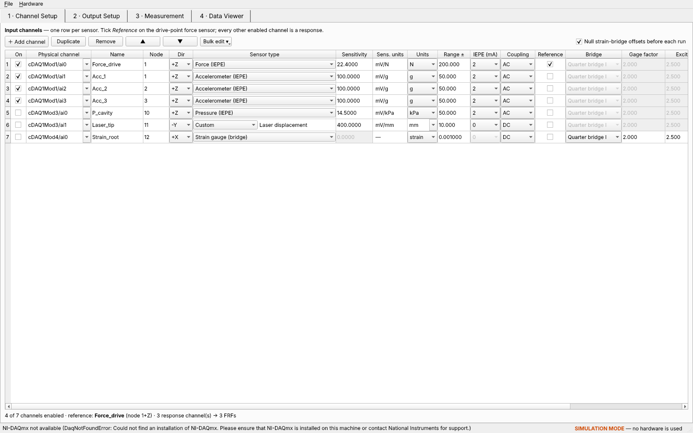

Each row is one input channel ([[fig:channels]]). Every enabled channel other than the reference
becomes one FRF response.

#+ATTR_LATEX: :environment longtable :align p{3.0cm}p{12.4cm}
| Column           | Meaning                                                                                                                                               |
|------------------+-------------------------------------------------------------------------------------------------------------------------------------------------------|
| On               | Include the channel in the measurement.                                                                                                               |
| Physical channel | DAQmx name, e.g. =cDAQ1Mod1/ai0= (pick from the list or type).                                                                                        |
| Name             | Channel name used in plots and files (and to match channels across runs in /Compare runs/).                                                          |
| Node, Dir        | Geometry node and direction (±X/Y/Z), written to the UFF files.                                                                                       |
| Sensor type      | Accelerometer, Force, Microphone or Pressure (IEPE); Strain gauge (bridge); Voltage; Custom (see below).                                              |
| Sensitivity      | From the calibration sheet, in the unit shown in *Sens. units* (mV/g, mV/N, mV/kPa, mV/mm, …).                                                       |
| Units            | Engineering unit. Editable for Voltage and Custom (pick or type).                                                                                     |
| Range ±          | Expected maximum level in engineering units; sets the input range.                                                                                    |
| IEPE (mA)        | IEPE excitation current; 0 = off. NI 9234 supports 2 mA.                                                                                             |
| Coupling         | AC for IEPE sensors; DC for strain and DC sensors; /Default/ leaves the module's default.                                                             |
| Reference        | The drive-point force sensor; FRFs are response / reference. Exactly one for random and stepped sine.                                                 |
| Bridge … Poisson | Strain gauges only: bridge configuration, gage factor, excitation voltage, nominal resistance, Poisson's ratio.                                       |

** Sensor types
- *Accelerometer / Force / Microphone (IEPE)*: native DAQmx channel types with IEPE excitation.
- *Pressure (IEPE)*: an IEPE pressure transducer; units kPa, Pa, bar, psi or MPa; sensitivity in mV
  per that unit; IEPE on by default. UFF type /pressure/.
- *Strain gauge (bridge)*: DAQmx strain channel using the bridge columns. /Null strain-bridge offsets
  before each run/ (top right) removes the static offset at the start of every run.
- *Voltage*: a plain voltage, scaled by the sensitivity (mV per unit) to any unit you type.
- *Custom*: any other sensor with a voltage output (laser vibrometer, displacement probe, …).
  Choose /Custom/, type the sensor's *name* in the field that appears next to the type
  (e.g. =Laser displacement=), pick or type its *unit* (mm, µm, m/s, …) and give the *sensitivity in
  mV per that unit*. Set IEPE if the sensor needs excitation. The name and unit are saved in the TDMS
  and UFF files (UFF type /general/). A custom channel without a name is refused at start.

Pressure, Voltage and Custom channels are measured as a voltage and scaled in software:
\( x_{\mathrm{EU}} = 1000\, v / S \) with \(v\) in volts and \(S\) in mV per unit.

** Editing the table
- *Add channel*, *Duplicate*, *Remove*, and the arrow buttons to reorder rows.
- *Bulk edit*: number the nodes of the selected rows, copy the sensor settings of the current row
  to the selected rows (including the custom name), or add every channel of a module at once.
- The summary line at the bottom states how many channels are enabled, which one is the reference,
  and how many FRFs that gives.

* Output Setup: common settings
#+CAPTION: Output Setup for the random suite: drive channel and limit, excitation group, blocks & timing, and the live summary and preview on the right.
#+NAME: fig:out-random
#+ATTR_LATEX: :width \textwidth :placement [H]
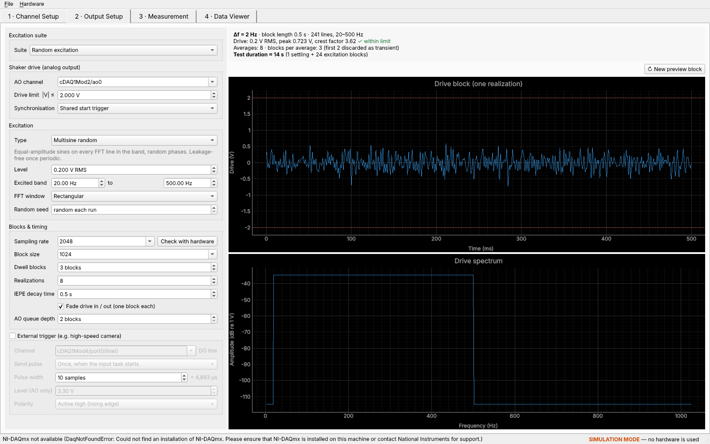

The left column holds the settings (drag the divider to resize it; it scrolls on small screens).
The right side shows a *summary* (Δf, line count, drive RMS/peak against the limit, test duration,
trigger timing) and *previews* of the drive and its spectrum, updated on every change
([[fig:out-random]]).

** Excitation suite
/Suite/ selects one of the four suites. Only the group of the chosen suite is shown, and the
Measurement tab follows this choice.

** Shaker drive (analog output)
- *AO channel*: the drive output, e.g. =cDAQ1Mod2/ao0=.
- *Drive limit |V| ≤*: a safety limit. A run is refused if any drive sample would exceed it; the
  controllers never exceed it. For the NI 9260 the program also checks the module's real output range
  (±4.24 V), using one common range for all channels of the AO task.
- *Synchronisation*:
  - /Shared start trigger/ (default): AO starts on the AI start trigger; both run at the same rate.
  - /AO clocked by AI sample clock/: the AO uses the AI sample clock (exact sample lockstep; not
    supported by every module combination).

** Blocks & timing
- *Sampling rate* and *Block size* (samples per block = FFT length). Δf = fs/N.
- *Dwell blocks*, *Realizations* (random suite only, Section [[*Random excitation suite]]).
- *IEPE decay time*: the drive is held at 0 V while the IEPE conditioners settle; the data is shown
  but not analysed.
- *Fade drive in / out*: one block of fade-in before and fade-out after the excitation.
- *AO queue depth*: how many blocks the output runs ahead. Larger values tolerate PC/USB hiccups
  but add latency (which slows the closed-loop controllers); 2–3 is a good default.

** Check the sampling rate with the hardware
#+CAPTION: /Check with hardware/: DAQmx coerced the requested 10000 Hz to 10240 Hz for this module combination; the output rate matches; rates every module supports exactly are listed as links.
#+NAME: fig:rate
#+ATTR_LATEX: :width \textwidth :placement [H]
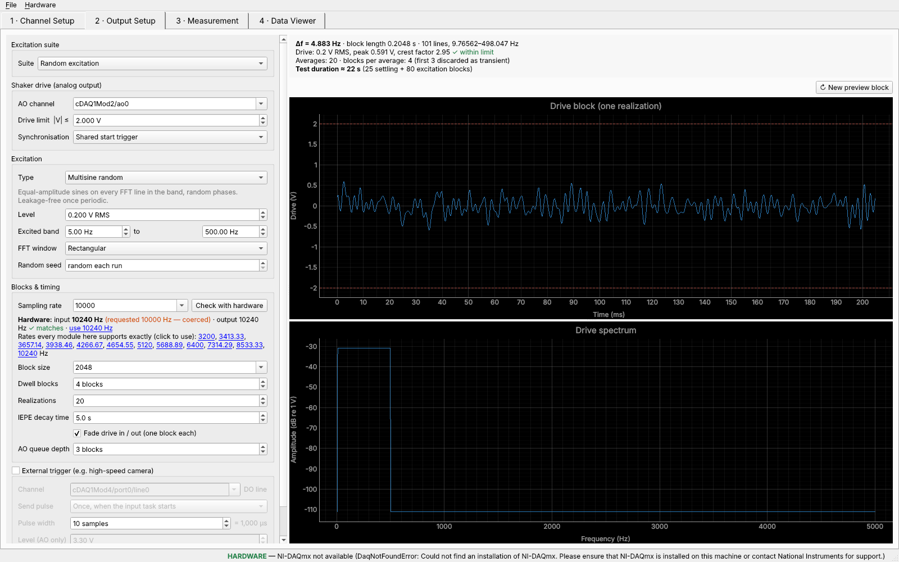

Delta-sigma modules (NI 9234, 9235, 9260, …) support only discrete rates, and modules in one task
share one master timebase, so DAQmx may use a rate different from the one you enter. *All input
channels are in one task*: every channel is always sampled at the same rate and at the same
instants, and the program always analyses with the rate DAQmx actually uses (it is logged at the
start of the run).

*Check with hardware* (next to the sampling rate) asks DAQmx --- without starting anything --- which
input and output rate it would really use for the enabled channels and the drive channel
([[fig:rate]]). It shows:
- the actual input rate, marked if coerced, with a link to use it;
- whether the output rate matches the input rate exactly (otherwise the excitation would leak);
- DAQmx's error if the rate is refused (e.g. 51.2 kHz with an NI 9235, whose maximum is 10.24 kHz on
  the 9234's timebase);
- up to 12 nearby rates that every module accepts *exactly*; click one to use it.

Using one of these exact rates makes the previews (Δf, frequency plans, Nyquist warnings) identical
to the run. In simulation mode the check only states that the simulator uses the rate as entered.

** External trigger (high-speed camera)
#+CAPTION: External trigger enabled: a 10-sample pulse on a DO line at the start of the converged block of each realization, with the pulse shape and the trigger timing in the summary.
#+NAME: fig:trigger
#+ATTR_LATEX: :width \textwidth :placement [H]
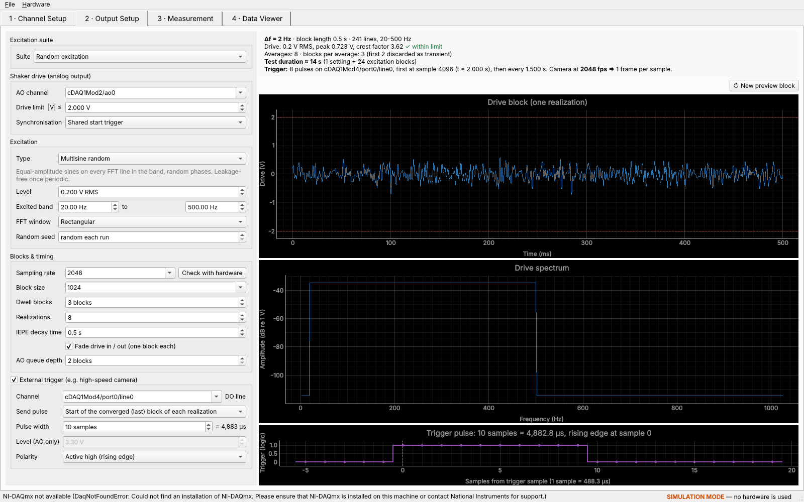

Tick *External trigger* to send a hardware-timed pulse to a camera or any other device
([[fig:trigger]]). The pulse goes out on a second AO channel (same AO task as the drive, so
sample-exact) or on a hardware-timed DO line (e.g. NI 9401, clean edges, no filter delay). Width
(samples), level (AO only) and polarity are adjustable; the plot shows one pulse sample by sample.
Every pulse's sample index and time are written to =<base>_trigger_log.csv=.

The modes are labelled for the current suite:

#+ATTR_LATEX: :environment longtable :align p{3.3cm}p{3.6cm}p{3.6cm}p{3.6cm}
| Random                                  | Stepped sine                                      | Harmonic                          | Phase Quadrature                              |
|-----------------------------------------+---------------------------------------------------+-----------------------------------+-----------------------------------------------|
| Once, when the input task starts        | Once, at the start of the acquisition             | Once, when the input task starts  | Once, when the input task starts              |
| Start of the converged block of each realization | Start of the converged (dwell) block at every frequency | Start of the converged test blocks | Start of the converged block of every level |
| Start of the dwell blocks of each realization | Start of every frequency step                     | Start of every control iteration  | Start of every drive level                     |
| Frame sync                              | Frame sync                                        | Frame sync                        | Frame sync                                    |

*Frame sync* routes the AI sample clock to a PFI terminal: one pulse per acquired sample, from
sample 0 to the end of the run. Drive the camera's external-sync (frame clock) input with it and
camera frame /f/ is AI sample /f/, with no drift. Note that delta-sigma inputs delay the signal by
their filter group delay (about 38 samples on the NI 9234); if sub-sample certainty is needed, also
record the trigger line on a spare AI channel.

* Random excitation suite
** Settings
#+CAPTION: Custom spectrum: the table of (frequency, value) points, presets, import/export, and the preview of the resulting FFT-line amplitudes.
#+NAME: fig:custom
#+ATTR_LATEX: :width \textwidth :placement [H]
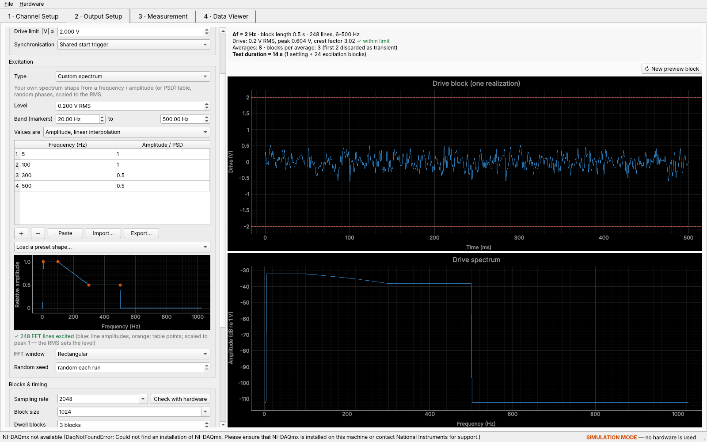

- *Type*: the excitation type (table below). *Level* is the drive RMS in volts.
- *Excited band*: f_min … f_max. It sets the lines excited by the band-limited types and the band
  markers on the plots. It never limits what is saved: FRFs are always stored from Δf to fs/2.
- *FFT window*: Rectangular (the right choice for every excitation here), Hann, Hamming, Blackman,
  Blackman-Harris, Flat top, Tukey (10 %), Kaiser-Bessel (β = 6).
- *Random seed*: fix it to repeat exactly the same random blocks.
- *Dwell blocks*: each random block is repeated this many times so the response becomes periodic;
  only the *last* (converged) block of each realization is used. *Realizations* = number of
  averages.

#+ATTR_LATEX: :environment longtable :align p{3.0cm}p{4.4cm}p{1.8cm}p{5.4cm}
| Type                           | Spectrum and phases                                          | Crest factor | Use it for                                                              |
|--------------------------------+--------------------------------------------------------------+--------------+-------------------------------------------------------------------------|
| Uniform random                 | white 0 … fs/2, random samples                               | ≈ 1.7        | quick broadband checks                                                  |
| Multisine random               | flat on every FFT line in the band, random phases            | ≈ 3–3.5      | general periodic-random FRFs                                            |
| Gaussian random (band-limited) | Rayleigh line amplitudes in the band, random phases           | ≈ 3.5–4      | true random statistics, nonlinearity checks                             |
| Periodic chirp                 | flat in the band, Schroeder phases (fast repeating sweep)    | ≈ 1.6–2      | most force per amplifier volt; deterministic (averaging reduces noise only) |
| Burst random                   | band-limited random for x % of the block, then silence        | ≈ 3–3.5      | lightly damped structures (response decays inside the block)            |
| Custom spectrum                | your table, amplitude (linear) or PSD (log-log), random phases | depends      | shaped spectra, test specifications                                     |

*Custom spectrum* ([[fig:custom]]): type the points, paste two columns from a spreadsheet, import or
export a CSV, or load a preset. Values are line amplitudes (linear interpolation) or a PSD shape
(log-log interpolation, i.e. straight dB/octave slopes). Only the shape matters; the level comes
from the RMS. The spectrum is zero outside the table's frequency range.

** How a random run works
#+begin_example
[0 V: IEPE decay] [fade-in] [R1 x D] [R2 x D] ... [RR x D] [fade-out] [0 V]
                     (R = realizations, D = dwell blocks)
#+end_example
With multisine, Gaussian, chirp, burst and custom excitation every excited frequency is an exact
FFT line \(k f_s/N\), so there is no leakage once the response is periodic. The log reports the
block-to-block change of the last two dwell blocks in %, which falls to the noise level once the
response has converged.

** Measurement tab (random)
#+CAPTION: Random suite during a run: live block of channel A, the recent-blocks strip (converged blocks shaded green), and coherence / FRF magnitude / phase after each realization.
#+NAME: fig:meas-random-run
#+ATTR_LATEX: :width \textwidth :placement [H]
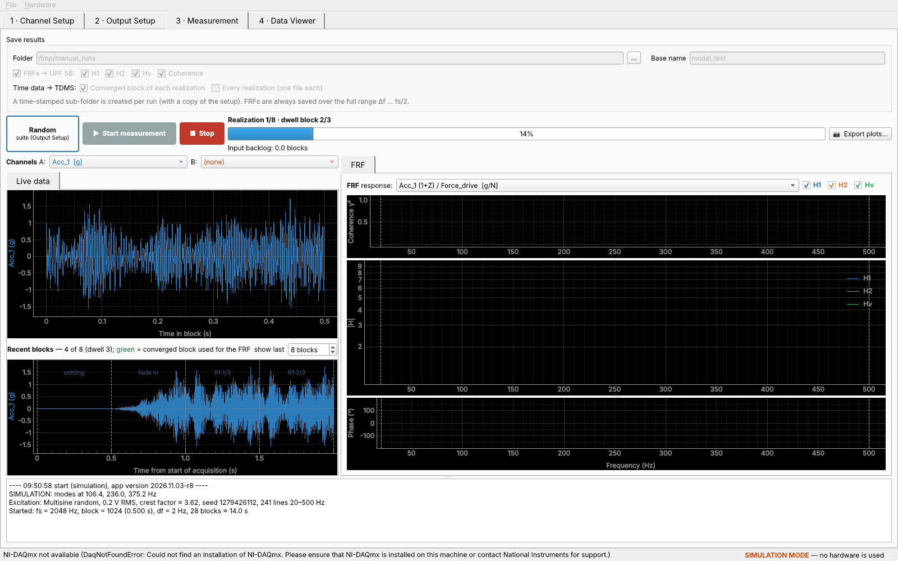

#+CAPTION: Random suite after 8 realizations: H1 (blue), H2 (orange) and Hv (green), coherence on top. The decaying live block shows the fade-out at the end of the run.
#+NAME: fig:meas-random-done
#+ATTR_LATEX: :width \textwidth :placement [H]
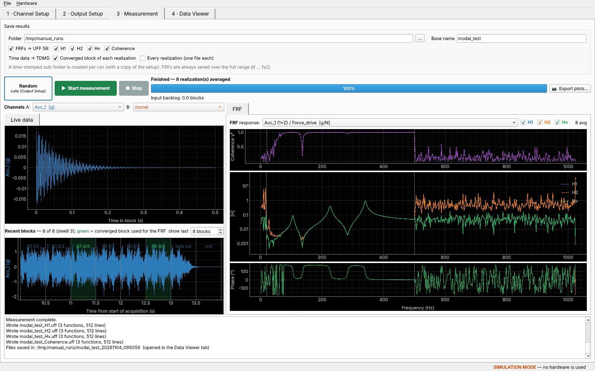

- *Live data*: the latest block of channels A and B (B on its own right axis). Below it the
  *recent-blocks strip*: the last N blocks (default dwell + 2, up to 100) on the acquisition time
  axis, with dashed separators, labels (=R3·2/4= = realization 3, dwell block 2 of 4), and the
  converged block used for the FRF shaded green. You can watch the transient die out.
- *FRF*: coherence, |H| and phase of the selected response (H1/H2/Hv tick boxes) from 0 to fs/2,
  updated after every realization; dashed lines mark the band.

** FRF estimators
With \(X\) the reference and \(Y\) a response spectrum at one line, averaged over the realizations:
\begin{align*}
G_{xx} &= \langle |X|^2 \rangle, \quad G_{yy} = \langle |Y|^2\rangle, \quad G_{xy} = \langle X^{*} Y\rangle,\\
H_1 &= \frac{G_{xy}}{G_{xx}} \quad\text{(noise on the response)}, \qquad
H_2 = \frac{G_{yy}}{G_{xy}^{*}} \quad\text{(noise on the reference)},\\
H_v &= \frac{G_{xy}}{G_{xx}-\lambda_{\min}} \quad\text{(total least squares; } \lambda_{\min}\text{ = smaller eigenvalue of }
\begin{bmatrix} G_{xx} & G_{xy}^{*}\\ G_{xy} & G_{yy}\end{bmatrix}\text{)},\\
\gamma^2 &= \frac{|G_{xy}|^2}{G_{xx} G_{yy}} .
\end{align*}
\(H_v\) always lies between \(H_1\) and \(H_2\).

** Saved files (random)
#+ATTR_LATEX: :environment longtable :align p{4.8cm}p{10.6cm}
| File                                   | Contents                                                                                           |
|----------------------------------------+----------------------------------------------------------------------------------------------------|
| =setup.json=                           | the exact setup (and app version)                                                                  |
| =<base>_H1.uff=, =_H2.uff=, =_Hv.uff=  | UFF 58 (function type 4, complex), one record per response, full range Δf … fs/2                  |
| =<base>_Coherence.uff=                 | UFF 58 (function type 6, real)                                                                     |
| =<base>_converged_blocks.tdms=         | one group per realization: the converged block of every channel plus =Drive= (and =Trigger=)       |
| =<base>_realization_NNN.tdms=          | optional: all dwell blocks of each realization                                                    |
| =<base>_trigger_log.csv=               | with the external trigger: sample index and time of every pulse                                   |

* Stepped-sine suite
** Settings
#+CAPTION: Stepped-sine settings: frequency plan on FFT lines, settle and dwell, secant control of a channel's RMS (or amplitude), failure handling and the number of harmonics. The orange line warns that higher orders are above Nyquist at the top frequencies.
#+NAME: fig:out-stepped
#+ATTR_LATEX: :width \textwidth :placement [H]
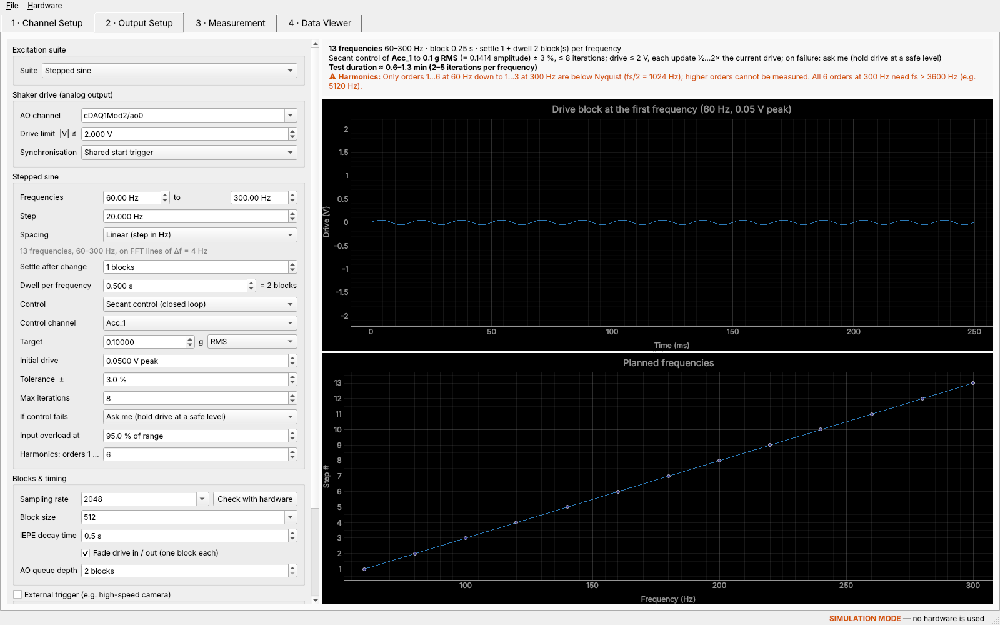

- *Frequencies* start … stop, *Step* (Hz, linear) or points per decade (logarithmic). Every
  frequency is snapped to an FFT line \(k f_s/N\) (whole cycles per block, leakage-free); points
  that fall on the same line are merged (the plan line says how many). Use a larger block for finer
  steps.
- *Settle after change*: blocks discarded after every change of frequency or drive level.
- *Dwell per frequency*: steady-state time analysed at each frequency (rounded up to whole blocks).
- *Control*:
  - /No control/: a constant drive amplitude (V peak) at every frequency.
  - /Secant control (closed loop)/: the *control channel* is driven to the *target* within ±
    *tolerance*. The target is either the block *RMS* or the *amplitude (RMS·√2)*, i.e. the peak of a
    pure sine with the same RMS.
- *Initial drive* (first frequency; later frequencies start from the previous drive), *Max
  iterations* (≥ 2), *If control fails*, *Input overload at* (% of range).
- *Harmonics: orders 1 … n*: the single setting for every harmonics display and the saved harmonics.

** Control
One iteration is /settle/ blocks plus one measured block at one drive amplitude. Because the output
runs /AO queue depth/ blocks ahead, the measured block is read that many blocks later; the drive is
held meanwhile.
\[
A_{k+1} = A_k - \bigl(y_k - y_{\mathrm{target}}\bigr)\,\frac{A_k - A_{k-1}}{y_k - y_{k-1}},
\qquad \tfrac12 A_k \le A_{k+1} \le 2A_k,\; A_{k+1}\le \text{drive limit}.
\]
The first update uses the origin as second point (a proportional step). If the response did not
grow with the drive, a proportional step is used. *Every frequency gets at least one refinement*:
the first iteration (with the drive carried over from the previous frequency) never counts as
converged.

Detected problems:
- *Input overload* (|peak| ≥ overload % of range): below the target it is a failure, above the target
  the drive is halved;
- *Drive limit* reached below the target;
- *Input saturation*: the target needs more drive than the level at which an input overloads;
- *Max iterations*.

With /If control fails: Ask me/ the drive is held at a safe level and a dialog offers *Retry*,
*Accept best and continue* (flagged), *Skip this frequency* or *Stop the test*
([[fig:dialog]]). The other options apply one of these automatically.

#+CAPTION: The dialog shown when control fails and the setup says /Ask me/.
#+NAME: fig:dialog
#+ATTR_LATEX: :width 0.75\textwidth :placement [H]
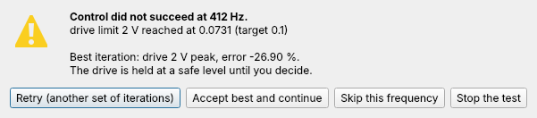

** Measurement tab (stepped sine)
#+CAPTION: Controller display during a stepped-sine run: status, iterations at the current frequency (control RMS and drive), the sweep overview and the colour-coded table of every frequency; FRF on the right.
#+NAME: fig:stepped-ctl
#+ATTR_LATEX: :width \textwidth :placement [H]
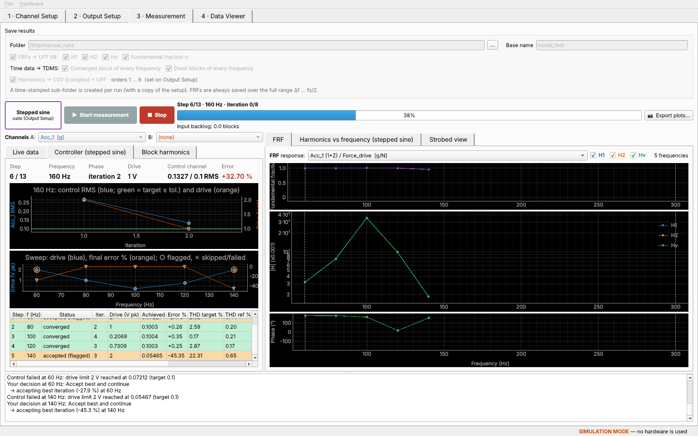

- *Controller (stepped sine)* ([[fig:stepped-ctl]]): step, frequency, phase, drive, control-channel level
  and error; the iterations at the current frequency with the target ± tolerance band; the sweep of
  drive and final error (flagged ○, skipped ✕); and a table of every frequency (status colours are
  translucent so they read well in light and dark themes).
- *FRF*: H1/H2/Hv at the measured frequencies, with the *fundamental fraction η* instead of the
  coherence.

#+CAPTION: Block harmonics (left: levels in dBc and one cycle with its Fourier series) and Harmonics vs frequency (right: several channels and orders, with Fundamental/Odd/Even toggles).
#+NAME: fig:stepped-harm
#+ATTR_LATEX: :width \textwidth :placement [H]
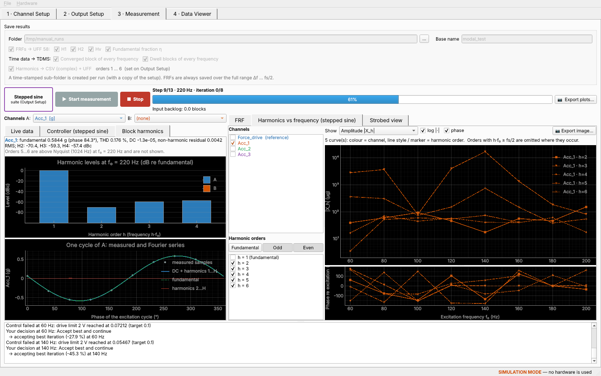

- *Block harmonics* ([[fig:stepped-harm]], left): harmonic levels of the latest block of A and B in dBc,
  one cycle of A with the Fourier series (fundamental, harmonics 2…n), THD, DC and the non-harmonic
  residual. Orders above Nyquist at the current frequency are left out and the readout says so.
- *Harmonics vs frequency* ([[fig:stepped-harm]], right): tick any channels and orders;
  *Fundamental*, *Odd* and *Even* tick or untick a whole group. Show the amplitude \(|X_h|\), the
  level re the channel's own fundamental (dBc) or the harmonic FRF \(|Y_h|/|X_{1,\mathrm{ref}}|\); the
  phase plot shows \(\varphi_h - h\,\varphi_{\mathrm{ref},1}\). Orders that were above Nyquist at every
  frequency are greyed out (/above Nyquist, not measured/).

#+CAPTION: Strobed view during the dwell at 260 Hz: three blocks folded onto one period with the fitted Fourier series.
#+NAME: fig:stepped-strobe
#+ATTR_LATEX: :width \textwidth :placement [H]
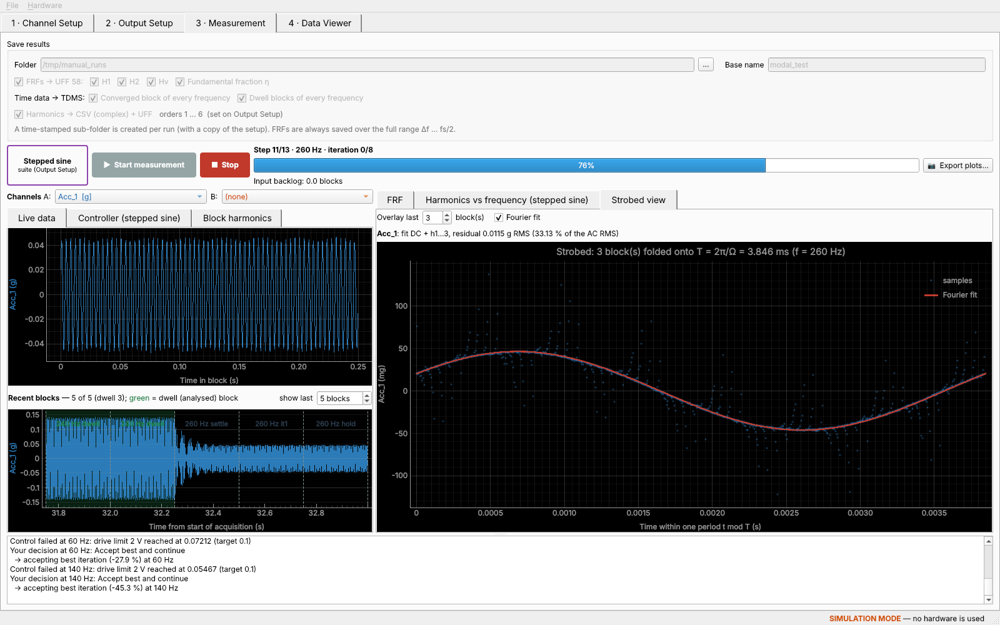

- *Strobed view* ([[fig:stepped-strobe]]): the samples of the latest blocks (same frequency and drive)
  folded onto one period, 0 … T = 2π/Ω, as a point cloud with the fitted Fourier series (DC +
  harmonics 1…n). The residual in % of the AC RMS shows what is not periodic in Ω (noise,
  transients, sub-harmonics). A settling block right after a frequency change shows its transient as
  scatter around the fit.

#+CAPTION: A finished stepped-sine run: the controller table and the FRF with the fundamental fraction η on top.
#+NAME: fig:stepped-done
#+ATTR_LATEX: :width \textwidth :placement [H]
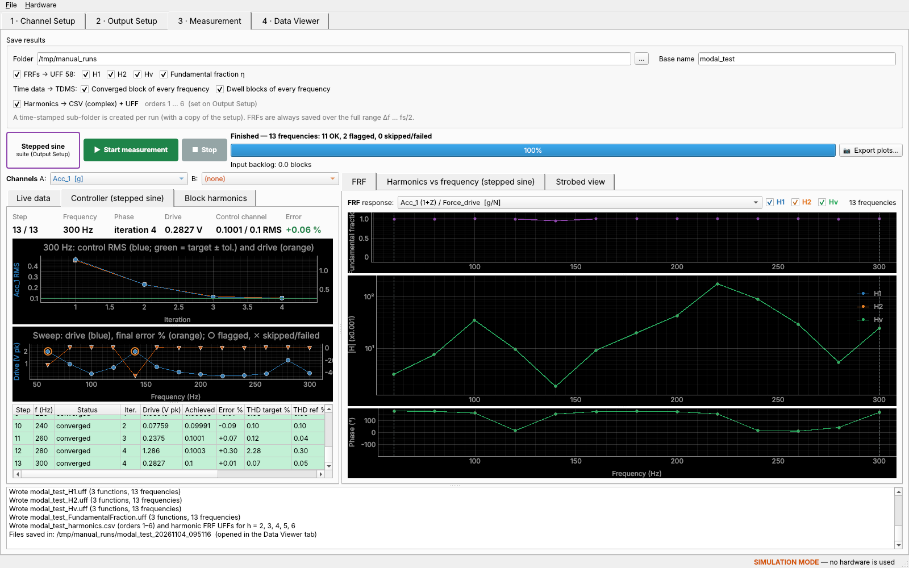

** Fundamental fraction instead of coherence
Coherence across identical dwell blocks only measures block-to-block repeatability: it is ≈ 1 for
any steady sine and blind to distortion. The stepped-sine suite therefore reports the *fundamental
fraction*
\[
\eta_c = \frac{|X_c(f_0)|^2/2}{\operatorname{var}(x_c)}, \qquad \eta_{\mathrm{FRF}} = \eta_{\mathrm{ref}}\;\eta_{\mathrm{resp}},
\]
the share of each channel's AC power at the excitation frequency, averaged over the dwell blocks.
It drops when harmonics, noise or transients are present.

** Harmonics and Nyquist
Harmonic \(h\) of \(f_0\) can only be measured if \(h f_0 < f_s/2\). At \(f_s = 5120\) Hz and
\(f_0 = 536\) Hz that means \(h \le 4\), whatever number is set. Output Setup warns before the run and
gives the rate that would allow all orders (10 orders at 536 Hz need \(f_s > 10.7\) kHz, e.g. 12.8 kHz on
the NI 9234).

** Saved files (stepped sine)
#+ATTR_LATEX: :environment longtable :align p{5.2cm}p{10.4cm}
| File                                     | Contents                                                                                                                        |
|------------------------------------------+---------------------------------------------------------------------------------------------------------------------------------|
| =<base>_H1/H2/Hv.uff=                    | UFF 58 at the measured frequencies (uneven abscissa)                                                                            |
| =<base>_FundamentalFraction.uff=         | η per response at the measured frequencies                                                                                      |
| =<base>_stepped_converged_blocks.tdms=   | option /Converged block of every frequency/: group =Step_NNN= per frequency with the time waveform of the accepted control block (every channel + Drive + Trigger) and its frequency, line, status, iteration, drive, target, achieved level, error, first sample index/time |
| =<base>_stepped_sine.tdms=               | option /Dwell blocks of every frequency/: all dwell blocks per frequency, with status, iterations, drive, error, THD            |
| =<base>_control_summary.csv=             | one row per frequency (as in the controller table)                                                                              |
| =<base>_control_iterations.csv=          | every control iteration                                                                                                          |
| =<base>_harmonics.csv=                   | option: complex harmonics 1…n (re, im, amplitude, phase, dBc) of every channel at every frequency                               |
| =<base>_Harmonic<h>.uff=                 | option: \(Y_h/X_1\) of every response for h = 2…n                                                                               |

* Harmonic suite
** Settings
#+CAPTION: Harmonic suite settings: base frequency (snapped to an FFT line), the table of target harmonics, Broyden control settings and the number of converged test blocks.
#+NAME: fig:out-harm
#+ATTR_LATEX: :width \textwidth :placement [H]
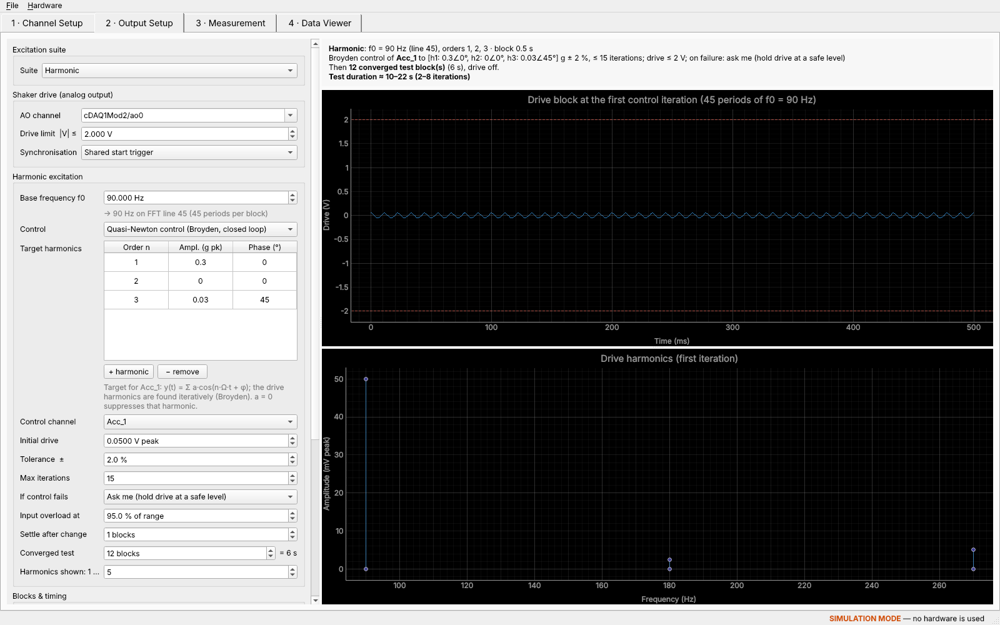

The drive is periodic in one base frequency,
\[ v(t) = \sum_i a_i \cos(n_i\,\Omega t + \varphi_i), \qquad \Omega = 2\pi f_0 . \]
- *Base frequency f0*, moved to the nearest FFT line (shown below the field), so that every block
  holds whole periods of every harmonic.
- *Harmonics table*: order n (whole number ≥ 1, each once), amplitude a (peak), phase φ (°). Use
  *+ harmonic* / *− remove*.
- *Control*:
  - /No control/: the table is the drive in volts (its peak must be within the drive limit).
  - /Quasi-Newton control (Broyden)/: the table is the *target* for the harmonics of the *control
    channel* (amplitude in its units). An amplitude of 0 means /suppress this harmonic/ (e.g. to
    cancel shaker distortion at 2Ω, 3Ω).
- *Initial drive*: the largest harmonic's drive at the first iteration (the others in proportion to
  their targets, at least 5 % so every harmonic is probed); *Tolerance*, *Max iterations*, *If
  control fails*, *Input overload at*, *Settle after change*.
- *Converged test*: how many converged blocks run before the drive fades out.
- *Harmonics shown: 1 … n*: orders used by the displays (at least the highest order in the table).

** Broyden control
The unknowns are the complex drive harmonics \(V_i\), handled as the real vector
\(x = [\operatorname{Re}V;\ \operatorname{Im}V]\); the residual is
\(r(x) = [\operatorname{Re}(Y-T);\ \operatorname{Im}(Y-T)]\) with \(Y\) the measured harmonics of the
control channel and \(T\) the targets.
\begin{align*}
B_0 &= \text{diagonal: each harmonic's own gain } Y_i/V_i,\\
x^{+} &= x - B^{-1} r,\\
B &\leftarrow B + \frac{(\Delta r - B\,\Delta x)\,\Delta x^{\mathsf T}}{\Delta x^{\mathsf T}\Delta x}
\quad\text{(Broyden's ``good'' update).}
\end{align*}
The updates learn the cross-coupling between harmonics (e.g. a nonlinear shaker that turns drive at
Ω into response at 2Ω). Safeguards: a harmonic's drive may at most double per step; the drive peak
stays within the limit; if the error grows by more than 1.5× the step is halved back.

*Error* of harmonic i: \(e_i = |Y_i - T_i| / s_i\) with \(s_i = |T_i|\), or the largest \(|T|\) for
targets below 10 % of the largest (so that suppressed harmonics are judged against the main
amplitude). It is a complex error: 3 % ≈ 3 % in amplitude and 1.7° in phase. *Converged* when every
\(e_i\) is within tolerance, never on the first iteration. Failures and actions are as in stepped sine.

** Measurement tab (harmonic)
#+CAPTION: Harmonic suite: controller (per-harmonic target, response, error and drive; max error over the control iterations in blue and the test blocks in orange, log scale) and the strobed view.
#+NAME: fig:meas-harm
#+ATTR_LATEX: :width \textwidth :placement [H]
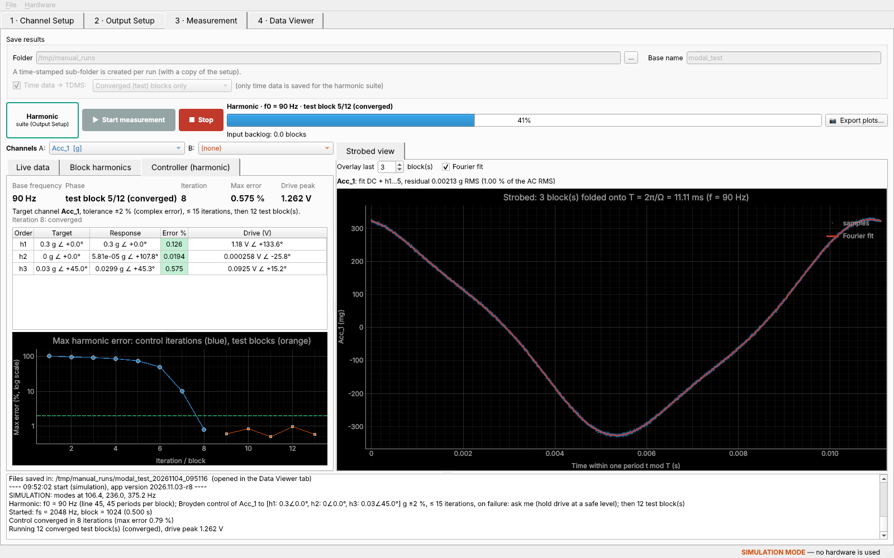

There is no FRF in this suite. The tabs are *Live data*, *Block harmonics*, *Controller (harmonic)*
and the *Strobed view* ([[fig:meas-harm]]).

** Saved files (harmonic) --- time data only
Measurement tab → /Time data → TDMS/ with /All blocks/ (everything from the start: IEPE settling,
every control iteration, the test, fade-out), /Converged (test) blocks only/, or /One converged block
every S seconds/.

#+ATTR_LATEX: :environment longtable :align p{4.8cm}p{10.6cm}
| File                              | Contents                                                                                                                       |
|-----------------------------------+--------------------------------------------------------------------------------------------------------------------------------|
| =<base>_harmonic.tdms=            | one group =Block_NNNNNN= per saved block: every channel + Drive (+ Trigger); properties: kind, iteration, test block, status, time, f0, drive harmonics, and with control the response harmonics and errors |
| =<base>_control_iterations.csv=   | control log: every iteration's drive, response and error per harmonic                                                           |

* Phase Quadrature suite (amplitude-dependent resonance)
** Settings
#+CAPTION: Phase Quadrature settings: drive levels (here 5 levels up, then down), initial frequency and search range, control mode, response and reference channels, quadrature phase and tolerances.
#+NAME: fig:out-pq
#+ATTR_LATEX: :width \textwidth :placement [H]
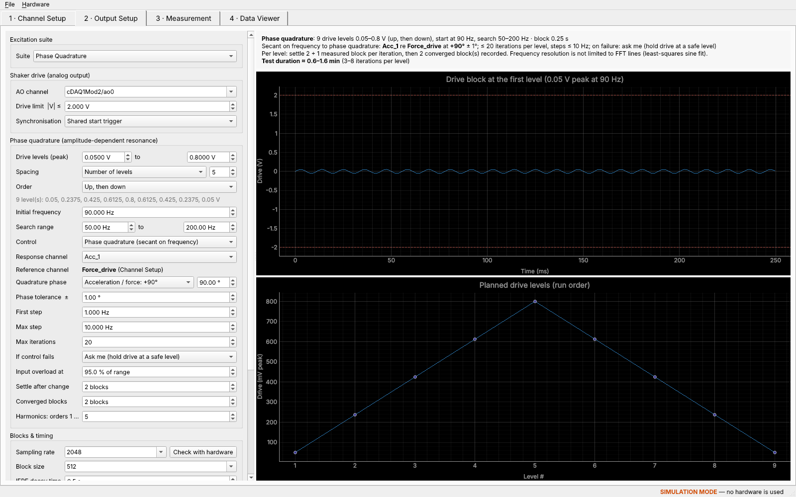

For every *drive level* (a sine of fixed voltage) the *frequency* is adjusted until the response is
at resonance; the converged block is recorded and the next level starts from that frequency.
Plotting resonance frequency against amplitude gives the *backbone curve* of a nonlinear mode.

- *Drive levels*: min … max (V peak), as a /number of levels/ or a /step/; order /ascending/,
  /descending/ or /up, then down/ (to see hysteresis or jumps).
- *Initial frequency*: first guess of the resonance. *Search range*: control fails outside it ---
  keep it tight around the mode you track.
- *Control*:
  - /Phase quadrature (secant on frequency)/: the phase of the response's fundamental relative to the
    reference's is driven to the *quadrature phase* --- presets acceleration/force +90°,
    velocity/force 0°, displacement/force −90°, or custom --- within ± *phase tolerance*.
  - /Reference-free/: the frequency of maximum \(|H_1| = |Y_1/X_1|\) is located to ± *frequency
    tolerance*. Without a reference channel, |response| per drive volt is maximised.
- *Response channel*; the *reference channel* is shown as set on Channel Setup.
- *First step*, *Max step* (Hz per iteration), *Max iterations*, *If control fails* (ask / accept
  best and continue / skip this level / stop), *Input overload at*, *Settle after change*,
  *Converged blocks* (recorded at the converged frequency, averaged and saved), *Harmonics*.

** How it works
- *Any frequency.* Unlike the other sine suites, the frequency is not restricted to FFT lines: the
  drive is a phase-continuous sine at the exact frequency and every block is analysed by a
  *least-squares fit* of DC and harmonics at that frequency against absolute time,
  \[ x(t) \approx c_0 + \sum_h \operatorname{Re}\{X_h e^{j 2\pi h f t}\}, \]
  which is unbiased with a non-integer number of periods per block. The frequency resolution is
  therefore not limited to Δf = fs/N.
- *Quadrature secant* on \(e(f) = \operatorname{wrap}(\varphi(f) - \varphi_{\mathrm{target}})\):
  \[ f^{+} = f - e\,\frac{f - f_{\mathrm{prev}}}{e - e_{\mathrm{prev}}} \]
  when the phase falls with frequency (as it does through a resonance); otherwise a fixed step towards
  quadrature (phase above target ⇒ raise f), scaled with |e|/45°. Steps are limited to ± max step and
  to the search range.
- *Reference-free*: probe steps until the peak of |H1| is bracketed, then parabolic refinement until
  the peak is located within the frequency tolerance. For a damped mode the |H1| peak is not exactly
  at phase quadrature (the difference is of the order of the damping).
- The first iteration of a level never counts as converged.
- Failures: input overload, search range exhausted, max iterations.

** Measurement tab (phase quadrature)
#+CAPTION: Phase Quadrature during a run: controller (frequency and phase error per iteration with the tolerance band, and the table of levels) and the strobed view at the current frequency (101.9 Hz, not an FFT line).
#+NAME: fig:pq-run
#+ATTR_LATEX: :width \textwidth :placement [H]
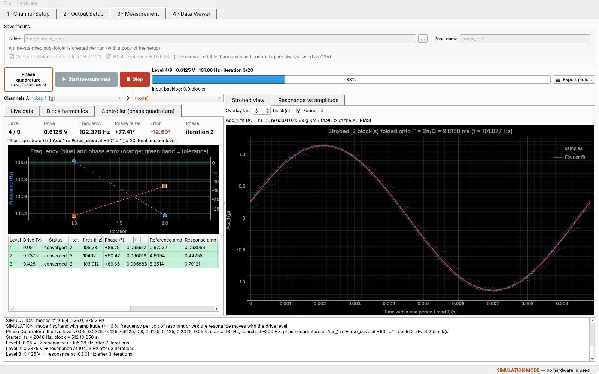

#+CAPTION: Phase Quadrature after an up-then-down sweep of 9 levels: the backbone (response amplitude vs resonance frequency; blue increasing, red decreasing level), |H1| and its phase at resonance.
#+NAME: fig:pq-done
#+ATTR_LATEX: :width \textwidth :placement [H]
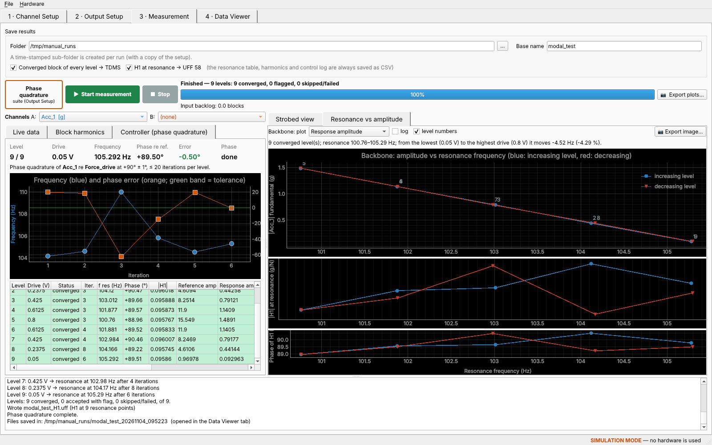

There is no FRF. Left: *Live data*, *Block harmonics* (least squares at the exact frequency) and
*Controller (phase quadrature)* ([[fig:pq-run]]). Right: *Strobed view* and *Resonance vs amplitude*
([[fig:pq-done]]): the backbone (choose response amplitude, reference amplitude, drive level, |H1| or
response per volt) against the resonance frequency, with level numbers; increasing levels in blue,
decreasing in red; and |H1| and its phase at resonance. The summary line gives the frequency shift
from the lowest to the highest drive level.

** Saved files (phase quadrature)
#+ATTR_LATEX: :environment longtable :align p{5.4cm}p{10.2cm}
| File                                       | Contents                                                                                                                       |
|--------------------------------------------+--------------------------------------------------------------------------------------------------------------------------------|
| =<base>_phase_quadrature.csv=              | one row per level: drive, status, iterations, resonance frequency, phase (response re reference) and its error, reference and response fundamentals (amplitude, re, im), *H1 = response/reference* (re, im, amplitude, phase), the *ratio of response to reference*, response per drive volt, THD, overload, reason |
| =<base>_pq_harmonics.csv=                  | complex harmonics 1…n of every channel at every level                                                                          |
| =<base>_control_iterations.csv=            | every iteration: level, drive, frequency, phase, phase error, objective, note                                                  |
| =<base>_phase_quadrature_blocks.tdms=      | option: the converged block(s) of every level (group =Level_NNN=), with the level's results as properties                      |
| =<base>_H1.uff=                            | option: H1 at the resonance of every level against frequency (UFF 58, uneven abscissa)                                          |

* Measurement tab: common elements
** Save results
The top group sets the *Folder* and *Base name*; each run creates its own sub-folder
=<base>_<YYYYmmdd_HHMMSS>= (with =_2=, =_3= … if two runs start within the same second) containing a
copy of the setup. The save options shown depend on the suite:
- Random: /FRFs → UFF 58/ (H1, H2, Hv, Coherence), /Time data → TDMS/ (converged block of each
  realization, every realization in its own file).
- Stepped sine: the same FRF row (with /Fundamental fraction η/), /Converged block of every
  frequency/, /Dwell blocks of every frequency/, and /Harmonics → CSV (complex) + UFF/.
- Harmonic: /Time data → TDMS/ with the block selection (all, converged only, one every S seconds).
- Phase Quadrature: /Converged block of every level → TDMS/ and /H1 at resonance → UFF 58/; the
  resonance table, harmonics and control log are always saved.

** Running a test
- The *suite badge* left of the Start button shows the suite chosen on Output Setup.
- *Start measurement*. On hardware a confirmation states the drive (level, frequency range, limit)
  and the trigger before the shaker moves.
- *Stop* fades the drive out smoothly and keeps everything completed so far.
- The *phase line* and the *progress bar* show where the run is; *Input backlog* warns if the PC
  falls behind (DAQmx raises an error rather than silently dropping data).
- *Channels A / B* above the tabs choose the two signals shown by every live view (sensors, the
  drive or the trigger).
- *Export plots…* saves the live and result plots as PNG (2× resolution), SVG or PDF. Every plot
  page in the Data Viewer has its own *Export image…* button.
- The *log* at the bottom records the settings, coerced rates, control decisions, warnings and the
  files written.

* Data Viewer
** Opening runs
Point *Folder* at a run folder or at a folder of runs and press *Scan*; choose a run from the /Run/
list. A finished measurement is opened here automatically. The *suite is detected automatically*
(from =setup.json=, or else from the file names): runs are tagged =[random]=, =[stepped]=,
=[harmonic]= or =[quadrature]=, a coloured badge shows the suite, and the summary lists the
settings and which files exist. Only the pages that apply to the run's suite are shown.

** Random runs
#+CAPTION: Data Viewer, random run: Frequency domain page with coherence, H1/H2/Hv magnitude and phase over 0 … fs/2, recomputed from the TDMS time data.
#+NAME: fig:v-freq
#+ATTR_LATEX: :width \textwidth :placement [H]
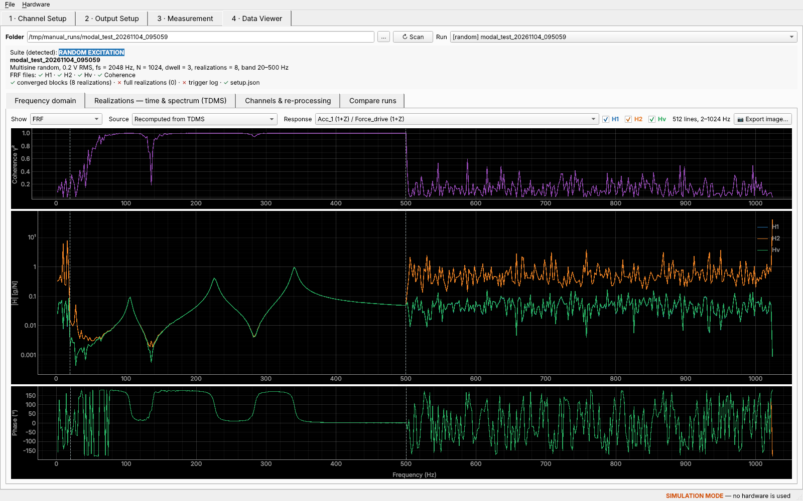

- *Frequency domain* ([[fig:v-freq]]): /Show: FRF/ (coherence or η, |H|, phase of any response) or
  /Amplitude spectrum/ of any single channel. /Source/: *Recomputed from TDMS* (from the time data,
  using the reference and labels of the channel table) or *Stored UFF files* (exactly as saved).

#+CAPTION: Realizations page: the converged block of a realization (green) and the amplitude spectrum of a chosen block.
#+NAME: fig:v-real
#+ATTR_LATEX: :width \textwidth :placement [H]
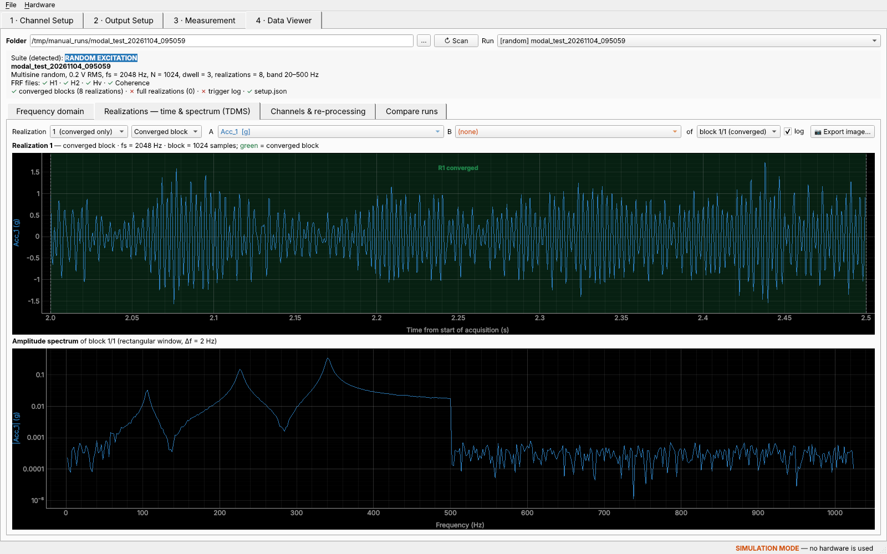

- *Realizations* ([[fig:v-real]]): pick a realization; see its converged block or, if saved, all its
  dwell blocks, for two channels, with the amplitude spectrum of a chosen block (lin/log).

#+CAPTION: Channels & re-processing: choose the reference and responses, edit names, nodes and directions, recompute and save a re-processed copy.
#+NAME: fig:v-chan
#+ATTR_LATEX: :width \textwidth :placement [H]
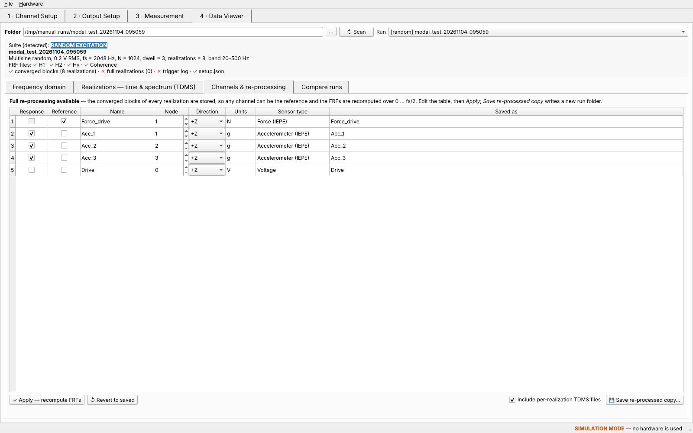

- *Channels & re-processing* ([[fig:v-chan]]): choose the *reference* (any channel --- e.g. an
  accelerometer for transmissibilities, or the drive voltage) and which channels are *responses*, and
  edit *names, nodes and directions*. *Apply* recomputes H1/H2/Hv/coherence from the converged
  blocks; *Save re-processed copy…* writes a new folder =<run>_reprocessed_<time>= with UFF and TDMS
  files carrying the new labels and an updated =setup.json=. The original run is never modified.
  Runs saved without converged-block time data can only be relabelled.

** Stepped-sine runs
#+CAPTION: Data Viewer, stepped run: Harmonics page with even orders ticked; works from the time data or, if no time data was saved, from the harmonics CSV.
#+NAME: fig:v-harm
#+ATTR_LATEX: :width \textwidth :placement [H]
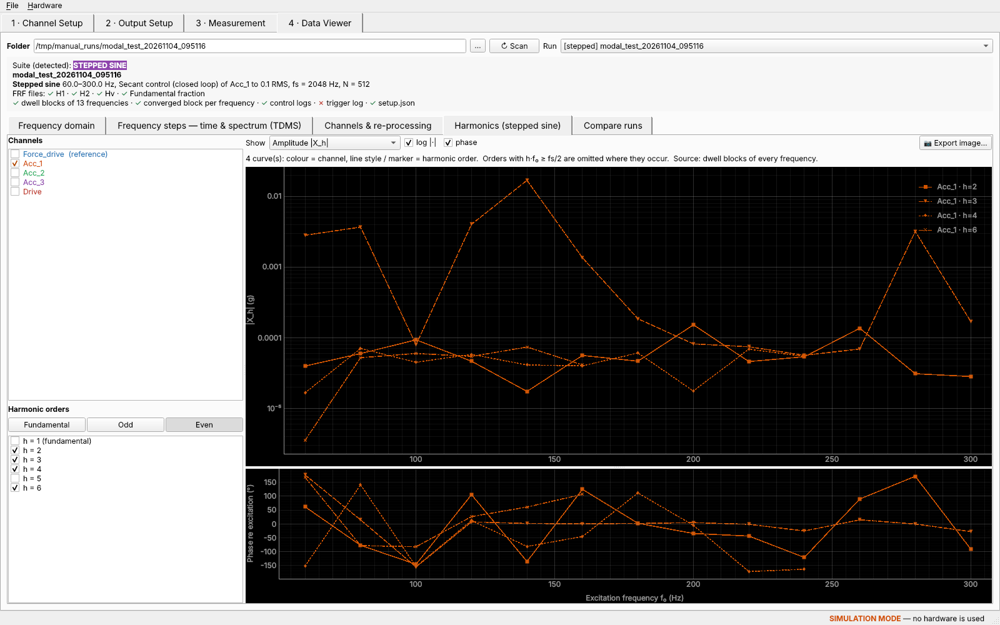

#+CAPTION: Frequency steps page with /Show: Strobed view/: all dwell blocks of the chosen step folded onto one period.
#+NAME: fig:v-strobe
#+ATTR_LATEX: :width \textwidth :placement [H]
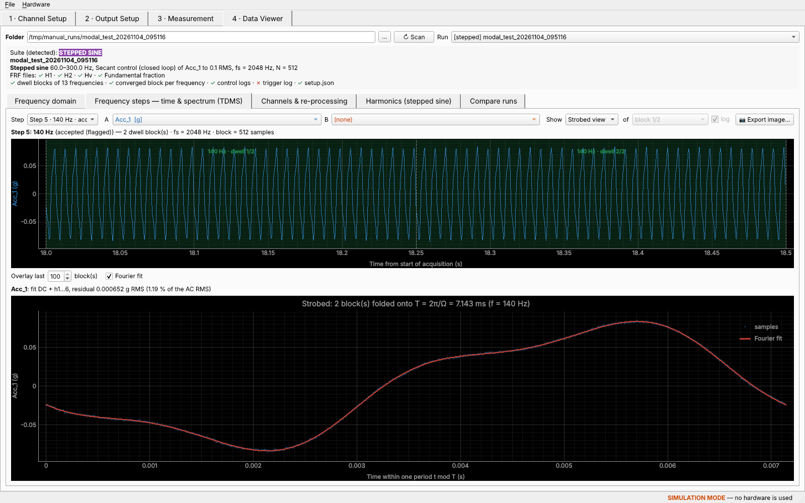

#+CAPTION: Frequency steps page with /Show: Harmonics/: harmonic levels and one cycle with its Fourier series for a flagged step at the drive limit (strong 3rd harmonic).
#+NAME: fig:v-blockharm
#+ATTR_LATEX: :width \textwidth :placement [H]
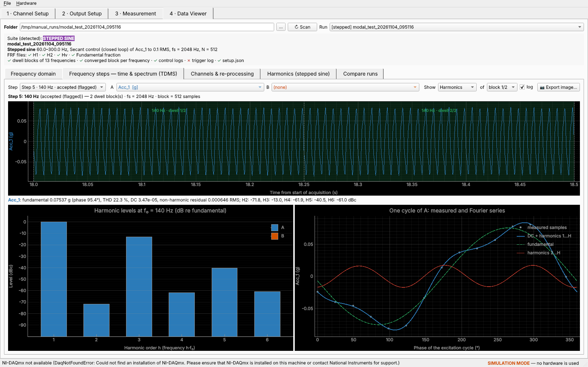

- *Frequency domain* and *Channels & re-processing* as for random runs (at the measured frequencies;
  η instead of coherence).
- *Harmonics (stepped sine)* ([[fig:v-harm]]): the Harmonics-vs-frequency page. It uses the dwell
  blocks, else the converged block per frequency, else the saved =<base>_harmonics.csv=; the page
  names its source. The order list always follows the number set for the run; unmeasurable orders
  are greyed out.
- *Frequency steps --- time & spectrum*: pick a step; below the time history choose /Show/:
  /Harmonics/ ([[fig:v-blockharm]]), /Spectrum/ of a chosen block, or /Strobed view/ ([[fig:v-strobe]]).

** Harmonic runs
#+CAPTION: Data Viewer, harmonic run: saved blocks with iteration/test number and error, the time history, drive and control properties, the harmonics of every channel, and the strobed view.
#+NAME: fig:v-hrun
#+ATTR_LATEX: :width \textwidth :placement [H]
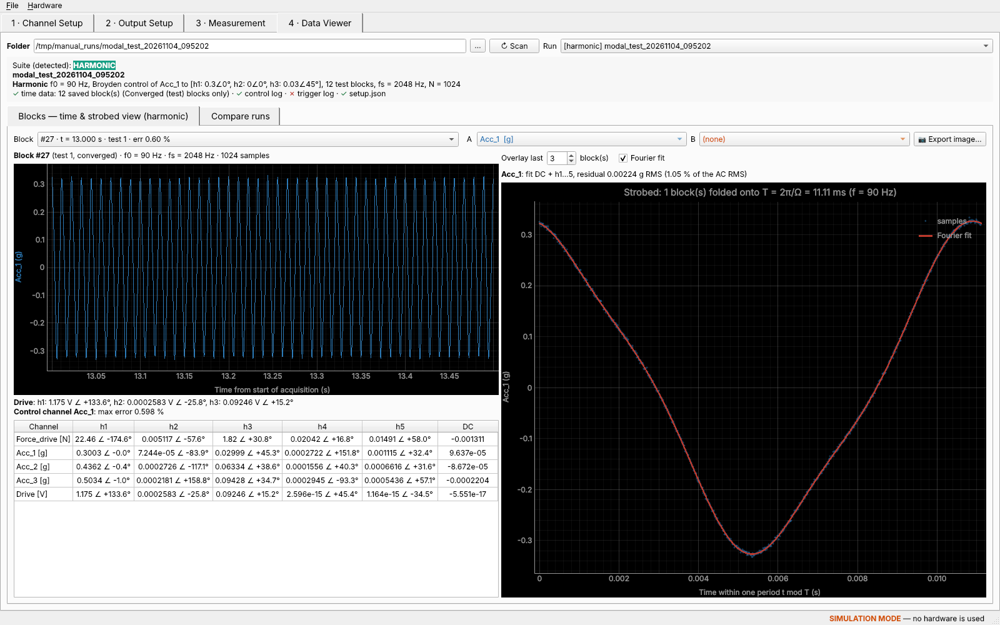

Harmonic runs have no FRF; they open on *Blocks --- time & strobed view* ([[fig:v-hrun]]). Pick a saved
block (the list shows iteration or test number and error); the strobed view overlays the preceding
saved blocks with the same drive.

** Phase-quadrature runs
#+CAPTION: Data Viewer, phase-quadrature run: backbone and H1 plots, the table of levels, and the level inspector (time history, strobed view of reference and response, harmonics of every channel).
#+NAME: fig:v-pq
#+ATTR_LATEX: :width \textwidth :placement [H]
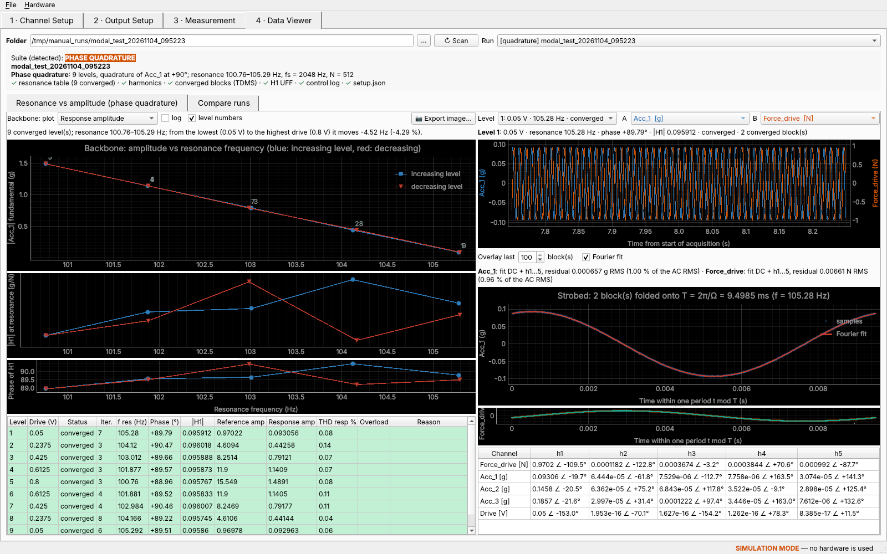

They open on *Resonance vs amplitude* ([[fig:v-pq]]): the backbone and H1 plots, the level table (click
a row to inspect it) and a level inspector with the converged block's time history, strobed view
and harmonics. Levels saved without time data show their harmonics from the CSV.

** Compare runs
#+CAPTION: Compare runs: a random run (line), a stepped-sine run (circles) and the H1 at resonance of every level of a phase-quadrature run (squares, dashed, in level order), for the same response channel.
#+NAME: fig:compare
#+ATTR_LATEX: :width \textwidth :placement [H]
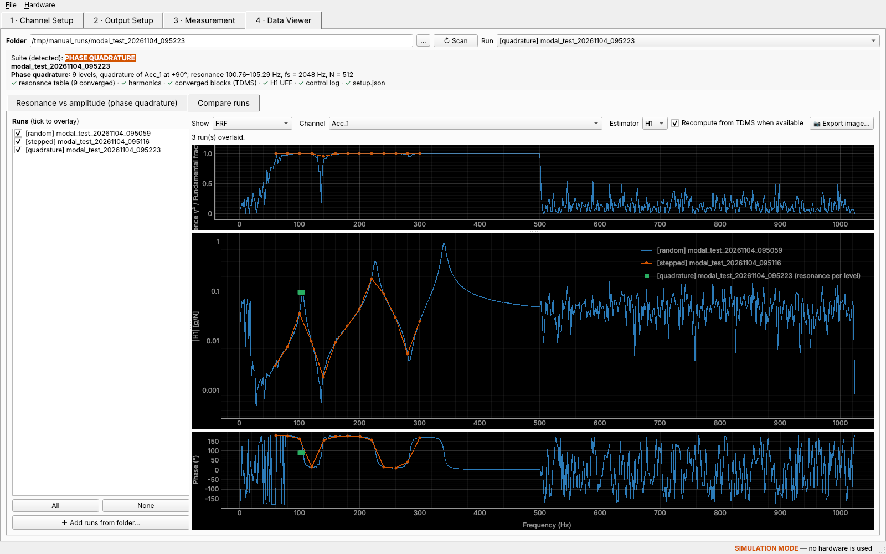

Tick several runs (from the scanned folder, or *Add runs from folder…*) and overlay the same
channel from each ([[fig:compare]]). Channels are matched by *name*; each run uses its own reference.
/Show: FRF/ (H1/H2/Hv; coherence or η on top; magnitude; phase) or /Amplitude spectrum/. Random runs
are drawn as lines, stepped-sine runs with markers at their frequencies, and phase-quadrature runs as
squares joined in level order --- so the frequency vs |H1| of a phase-quadrature backbone can be
compared directly with a stepped-sine or random FRF. Harmonic runs (no FRF) are not offered.

* Hardware notes
- *Delta-sigma rates.* NI 9234/9232/9250/9235/9236/9260 support only discrete rates (master
  timebase ÷ 256 ÷ n). Modules in one task share one timebase. The NI 9234 (13.1072 MHz) and the NI
  9235 (12.8 MHz, max 10 kS/s) together run at 51.2 kHz ÷ n with n ≥ 5: 10240, 8533.3, 7314.3, 6400,
  5689, 5120, … Hz. Use *Check with hardware* to see the exact choices for your modules.
- *All inputs in one task* --- one sample clock; different channels can never be sampled at different
  rates within a run.
- *AO and AI rate.* The output task is checked to run at exactly the input rate; otherwise the log
  warns (the excitation would not be periodic in the input block). /AO clocked by AI sample clock/
  forces lockstep where the modules allow it.
- *NI 9260 output range.* ±4.24 V; the program uses one common range for all AO channels (the 9260
  rejects mixed ranges).
- *Filter delay.* Delta-sigma inputs and outputs delay signals by their filter group delay; FRFs
  between inputs of the same module type are unaffected, and the controllers measure what they
  control, so the delay is compensated automatically.
- *AO queue depth* trades robustness against latency. Closed-loop suites slow down with deep queues.
- *IEPE settling*: allow several seconds of decay time after power-up of IEPE sensors.

* Troubleshooting
#+ATTR_LATEX: :environment longtable :align p{4.8cm}p{10.6cm}
| Symptom                                               | What to do                                                                                                                                          |
|-------------------------------------------------------+-----------------------------------------------------------------------------------------------------------------------------------------------------|
| Log says /AI sample rate coerced by hardware/          | Normal for delta-sigma modules; results use the actual rate. Choose an exact rate with *Check with hardware* so previews match.                     |
| DAQmx refuses to start (unsupported rate)             | A module cannot run that fast (e.g. NI 9235 above 10.24 kHz). Pick a rate from the *Check with hardware* list.                                       |
| Fewer harmonics than set                              | They are above Nyquist (\(h f_0 \ge f_s/2\)); Output Setup and the log say which; raise fs.                                                          |
| Stepped-sine control fails at the drive limit         | The target is unreachable there (anti-resonance or low mobility): lower the target, raise the limit, or accept/skip.                               |
| /Input overload/                                     | Increase the channel range, reduce the target or the drive level.                                                                                     |
| Phase quadrature converges to the wrong mode          | Narrow the search range, start closer to the mode, reduce the max step.                                                                              |
| Phase quadrature never reaches the tolerance          | Increase settle blocks (transients), check the quadrature phase convention of your sensors (use /Custom/ phase if needed).                           |
| /Input backlog/ grows, or AO underflow error           | The PC cannot keep up: larger blocks, larger AO queue depth, fewer channels or a lower rate.                                                        |
| Large scatter in the strobed view                     | The block is not steady (settling, beating with a nearby mode, nonlinearity); more settle blocks, or inspect it as intended.                       |
| =qt.qpa.wayland.textinput= messages in the terminal    | Harmless; muted by default (Section [[*Ubuntu / Wayland note]]).                                                                                     |

* Appendix: file formats
** TDMS
Every TDMS file has root properties with the setup (suite, rate, block size, …, app version) and one
group per block, realization, step or level. Every channel carries =wf_increment= (1/fs),
=unit_string=, node, direction, sensor type (the custom name for custom sensors), sensitivity and
its unit, and the physical channel; the =Drive= signal (and =Trigger=, if used) is stored alongside.
Files open in DIAdem, LabVIEW, or Python with =nptdms=:
#+begin_src python
from nptdms import TdmsFile
f = TdmsFile.read("modal_test_stepped_converged_blocks.tdms")
g = f["Step_005"]
print(g.properties["frequency_Hz"], g["Acc_1"][:])
#+end_src

** UFF 58
FRFs are written as UFF dataset 58 (pyuff): function type 4 (FRF, complex) or 6 (coherence) or 0
(general, e.g. η), response and reference node/direction (±X/Y/Z → ±1/2/3), channel names, units and
specific data types (acceleration, force, pressure, strain, general). Stepped-sine and
phase-quadrature files use an uneven abscissa (the measured frequencies).

** CSV
All CSV files have a header line, one row per item, comma separators and complex quantities as
separate =re= / =im= columns (plus amplitude and phase in degrees where useful).

* Appendix: license
pymodalshaker is free software, distributed under the GNU General Public License, version 3 or (at
your option) any later version, WITHOUT ANY WARRANTY. See the =LICENSE= file and /Help → About/.
The Help menu's About box shows the version and the license notice.

* Appendix: project layout
#+begin_example
pymodalshaker/
  config.py          setup dataclasses, validation, JSON
  excitation.py      random-suite generators
  frf.py             spectral averaging, H1/H2/Hv, coherence
  backends.py        NI-DAQmx continuous AI/AO backend, simulator, rate check
  engine.py          random suite: block scheduler / measurement loop
  stepped.py         stepped-sine suite: secant controller, single-line FRFs
  harmonic_suite.py  harmonic suite: multi-harmonic drive, Broyden controller
  pq_suite.py        phase-quadrature suite: resonance tracking per level
  harmonics.py       Fourier-series decomposition (FFT lines and least squares)
  results.py         reading saved runs back (Data Viewer)
  export.py          UFF 58 and TDMS writers
  gui/               PySide6 tabs and widgets
#+end_example
